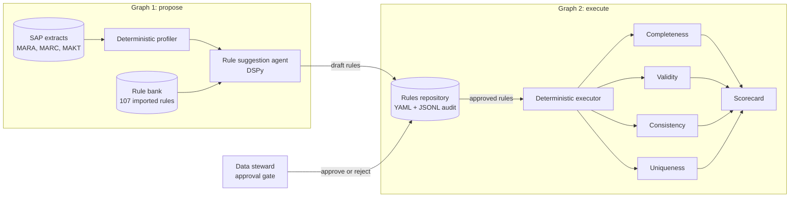

<!-- TODO(owner): confirm the "What I would change" text, and the reason given for rejecting jaro_winkler. -->

## Context

SAP material master data (MARA, MARC and MAKT) drives planning, procurement and maintenance. Data quality teams measure it against the DAMA dimensions. They write and maintain the rules by hand, often in SAP Information Steward.

## Problem

Writing rules by hand is slow, and the rules drift from the data. If an agent infers rules from the data instead, it can learn the current errors as if they were correct. The system must use AI judgement where it helps and stay deterministic everywhere else.

## My role

Sole architect and developer. I built AgentDQ with AI coding agents, under my design, direction and testing.

## Key decisions

1. **Agents only where judgement is needed.** Agents profile the data and propose rules with reasons, evidence and a confidence score. A deterministic executor runs only the approved rules. *Rejected:* an agent in every step, including rule execution. That makes results hard to repeat and hard to audit.
2. **Two LangGraph graphs, joined by a rules repository.** The first graph profiles and proposes rules. The repository holds each rule as draft until a person approves it. The second graph runs the approved rules. *Rejected:* `interrupt()` inside one graph. Approval can take days, and the repository gives a durable state with an audit ledger.
3. **`token_sort_ratio` for fuzzy matching.** The uniqueness check compares material descriptions that often hold the same words in a different order. *Rejected:* `jaro_winkler`, which rewards a shared prefix and so scored decoy records as duplicates.

## Architecture

Every state change writes an append-only audit entry with the rule, the actor, the reason and a diff. Agents cannot make a rule stronger. Only a person can, and that change is audited and reversible.

## Evidence

- 245 automated tests.
- After the matching change, the decoy error rate fell from 78% to 39%.
- Precision and recall of 1.0 on injected defects. This proves that the executor finds the defects the injector labels. It does not prove accuracy on real-world data.
- Four DAMA dimensions built: completeness, validity, consistency and uniqueness.
- Runs on SAP Cloud Appliance Library extracts and finds real completeness gaps in that data.

## Status

Proof of concept. Accuracy and timeliness are not built yet. Nobody uses it in production.

## What I would change next time

I would build the defect injector and the scoring before the first agent, so that every design choice has a measure from the first day.
