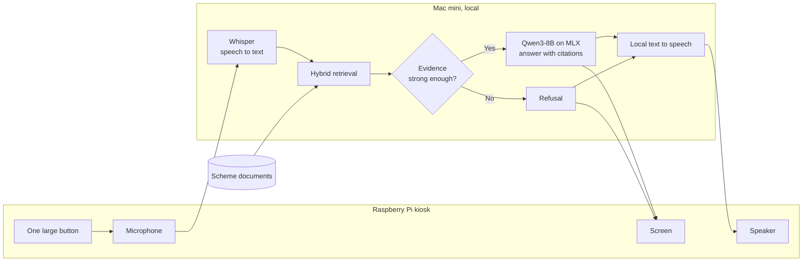

<!-- TODO(owner): confirm the Problem wording and the "What I would change" text. -->

## Context

KaKi-Talkie came from a group design-thinking project. The users are elderly residents in Singapore who want answers about government schemes. Many prefer to speak, in English or Malay, than to read a website.

## Problem

Scheme information is online and full of text. A wrong answer about eligibility can cost a resident a benefit. The kiosk must be simple to use, answer from official sources and say "I do not know" when the evidence is weak.

## My role

Sole developer in the group. I ran a four-week build with work packages, numbered acceptance tests and AI coding agents.

## Key decisions

1. **All AI runs locally on one Mac mini.** Speech-to-text (Whisper), the language model (Qwen3-8B on MLX) and text-to-speech run on the device. *Rejected:* cloud speech and model APIs. The residents' voices would leave the device, and the kiosk would need a reliable network.
2. **Hybrid retrieval with citations and a refusal gate.** Hybrid retrieval finds the source passages, and each answer cites them. When the evidence is weak, the kiosk says so and does not guess. *Rejected:* answers from the model's own knowledge, which can state wrong scheme details with confidence.
3. **A thin client with one large button.** A Raspberry Pi with one large button and a screen sends audio to the Mac mini. *Rejected:* a phone or touch-screen app, which asks more steps from elderly users.

## Architecture

## Evidence

Not yet measured.

## Status

Prototype, from a four-week build.

## What I would change next time

I would test with residents in week two, not at the end. Speech and pace problems show up only with real users.
