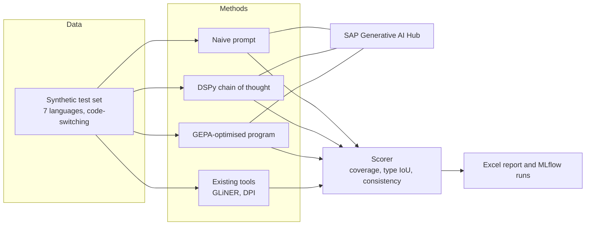

<!-- TODO(owner): confirm the number of entity types the framework supports before you publish it. The earlier page said 17. -->
<!-- TODO(owner): confirm the status label (Prototype) and the "What I would change" text. -->

## Context

An internal SAP team must decide whether to invest in anonymisation based on large language models. Today it uses existing tools, GLiNER and a DPI service, to find and mask personally identifiable information (PII). The data comes in many languages, and people often mix languages in one record.

## Problem

Nobody could say with numbers whether a language model finds more PII than the current tools. A demo that "looks good" does not support an investment decision.

## My role

Technical lead and designer of the evaluation framework, from November 2025 to June 2026.

## Key decisions

1. **Score at three levels, not with one F1 number.** The scorer measures mention coverage (did we hide every mention), type accuracy (did we label it correctly, with IoU span matching) and index consistency (does the same person keep the same placeholder). *Rejected:* one entity-level F1. One number hides the privacy misses that matter most.
2. **Compare three tiers of the same model.** A naive prompt, a DSPy chain-of-thought program and a GEPA-optimised program run against the same data. *Rejected:* one tuned prompt against the existing tools. That result cannot show which part caused a gain.
3. **Use a synthetic multilingual test set.** It covers seven languages (English, German, Chinese, French, Spanish, Japanese and Portuguese), local PII formats and three levels of code-switching. *Rejected:* samples of real records, which contain the personal data under test.

## Architecture

Prompts are DSPy signatures, not hand-written strings. The model calls go through SAP Generative AI Hub. The design also covers two hosting patterns on SAP AI Core: one with Databricks (MLflow tracking, Delta Lake storage) and one on SAP BTP Cloud Foundry.

## Evidence

Not yet measured. The comparison results are not published.

What exists today:

- A technical design document with 12 sections.
- An English data set of 300 records, split into training, validation and test.
- A scorer with configurable IoU thresholds, entity equivalence groups and automated Excel reports with charts.

## Status

Prototype. The design and the English data set are complete. The DSPy pipeline and GEPA optimisation are in build.

## What I would change next time

I would build the scorer and a small test set in week one, before the full design document. Early scores show which design questions matter.
