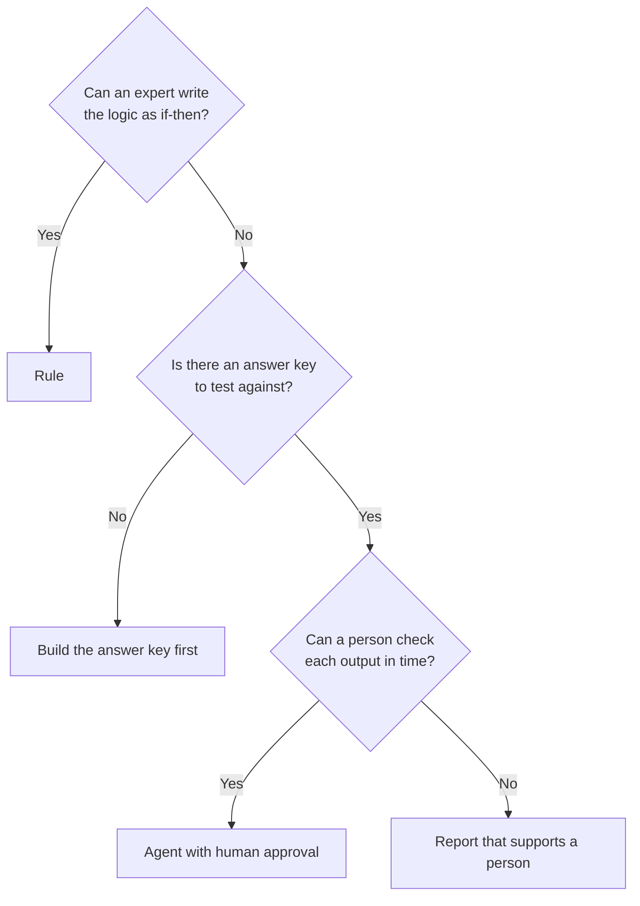

## Why ask first

Customers often bring an idea that starts with "an agent that...". An agent costs more to build, test and run than a rule or a report. So I ask five questions before anyone draws an architecture. The answers decide the tool.

## The five questions

1. **Trigger.** What starts the work? A schedule, a business event or a person?
2. **Inputs.** What does a person read to do the work today? Fields in one system, data across systems, or free text and documents?
3. **Difficulty.** Can an expert write the logic down as if-then steps? Or does the work need judgement, ranking and explanation?
4. **Ground truth.** Is there a known right answer for past cases? Can we build an answer key to test against?
5. **Cost of error.** What happens when the output is wrong? Who sees it, and how fast can they correct it?

## How the answers decide

| Answer pattern | Build |
| --- | --- |
| Fixed schedule, structured inputs, no decision | A report |
| Event trigger, structured inputs, logic an expert can write down | A rule |
| Mixed or unstructured inputs, judgement needed, an answer key exists | An agent, with a person approving each action |
| Judgement needed, but no ground truth | No build yet. Create the answer key first |
| High cost of error and no way to check the output | A report that supports a person, not an agent |

## What the method prevents

- Agents that do the work of a rule, at higher cost and with less control.
- Builds that start without a way to measure accuracy.
- Designs where a wrong answer reaches a customer or a ledger with no review.

The answers also feed the next steps: the [design rule](../code-calculates-ai-explains/), the [value case](../value-before-build/) and the [gate plan](../plan-to-hypercare/).
