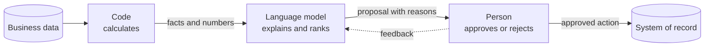

## The rule

Every agent I design splits the work into three parts:

1. **Code calculates.** Deterministic code produces every number: stock positions, totals, matches, scores. The same input gives the same output, every time.
2. **AI explains.** The language model reads the results of that code. It explains them in plain words, ranks the options and drafts the next step.
3. **A person decides.** A named person approves each action before it changes a system of record.

## Why

- **Numbers must be reproducible.** An auditor can rerun the code. Nobody can rerun a model's arithmetic and get the same result.
- **Language models are good at language.** They summarise, compare and explain well. That is where they add value.
- **Accountability stays with a person.** The person who approves an action owns it, as they do today.

## Rules that follow from it

- The model never writes a number that does not come from a tool result.
- Every claim in an explanation points to the tool output it came from.
- Every action is a proposal until a person approves it.
- Every approval and rejection is logged with the reason.

## Where I applied it

The same split runs through [AgentDQ](/builds/agentdq/): agents propose data quality rules, a data steward approves them, and a deterministic executor runs them. It also shapes each [customer engagement](/enterprise-ai/#customer-engagements) in solution design today.
