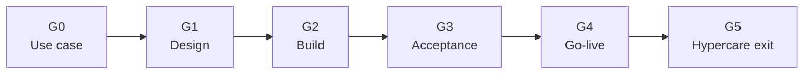

## The rule

An agent is not done when tests pass. It is done when it runs in the business, the measure is stable and a named owner has taken it over. So the plan ends at hypercare exit, and every gate has an owner.

## The gates

| Gate | Name | Exit criteria |
| --- | --- | --- |
| G0 | Use case accepted | The [five discovery questions](../agent-discovery-five-questions/) have answers. The build type is agreed. |
| G1 | Design approved | Architecture, data access, value case and AI governance review are signed off. |
| G2 | Build complete | The agent passes its tests against the answer key. |
| G3 | Acceptance passed | Key users accept it on real scenarios. Security and governance checks pass. |
| G4 | Go-live | Cutover is done. Monitoring and logging are on. Users are trained. |
| G5 | Hypercare exit and handover | The value measure is stable. The runbook is complete. The support owner accepts the handover. |

## The RACI

R: responsible. A: accountable. C: consulted. I: informed.

| Activity | Business owner | Key users | Customer IT | Build lead | Architect |
| --- | --- | --- | --- | --- | --- |
| Discovery and value case | A | C | C | R | C |
| Solution design | C | C | C | R | A |
| Build and test against answer key | I | C | C | A | R |
| User acceptance | A | R | C | R | I |
| Go-live and cutover | A | I | R | R | C |
| Hypercare and handover | A | C | R | R | I |

## Why

- **Most agent risk appears after go-live.** Real data, real users and edge cases arrive in hypercare.
- **Handover needs a receiver.** If nobody owns support, the agent stops when the project team leaves.
- **Gates stop weak builds early.** A failed G1 costs days. A failed go-live costs trust.
