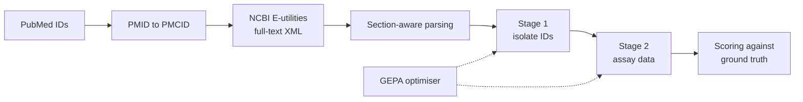

<!-- TODO(owner): reconcile the micro-F1 figures (0.52 to 0.65) with the stage F1 figures on the old ai-projects page (Stage 1: 87%, Stage 2: 78.5%). This page shows only micro-F1. -->
<!-- TODO(owner): confirm the status label and the "What I would change" text. -->

## Context

The Singapore Food Agency tracks pathogens through published research. Staff read papers to find isolates and the assays used on them. An existing tool based on BERT does part of this work.

## Problem

Manual review is slow, and the BERT tool misses fields. The agency needs more accurate extraction that also works across pathogens: E. coli, Salmonella, Campylobacter, Listeria and Hepatitis A and E.

## My role

Researcher and developer for my NTU MSc capstone, from August 2025 to March 2026.

## Key decisions

1. **Read full-text XML, not PDFs.** The pipeline converts PMIDs to PMCIDs and pulls XML through the NCBI E-utilities API, within NCBI rate limits. *Rejected:* PDF text extraction, which breaks tables and section order.
2. **Extract in two stages.** Stage 1 finds isolate IDs. Stage 2 extracts assay data for each isolate. Section-aware annotation stops errors in one stage from flowing into the next. *Rejected:* one pass that extracts everything at once.
3. **Program the prompts with DSPy and optimise them with GEPA.** *Rejected:* hand-written prompts. They are hard to compare and hard to improve in a controlled way.

## Architecture

GenBank accession numbers are found with more than 200 documented NCBI format patterns.

## Evidence

- Strict micro-F1 rose from 0.52 to 0.65 with DSPy and GEPA.
- About 1,800 documents processed by the downloader.
- The method held across the pathogen types in the study.

## Status

Research complete. The MSc was conferred in 2026.

## What I would change next time

I would fix the ground truth guide before the first experiment, so that labels stay the same across both stages.
