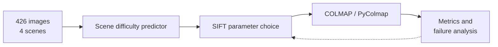

<!-- TODO(owner): confirm the status label and the "What I would change" text. -->

## Context

A team of five studied Structure from Motion (SfM) on four NTU campus scenes. Each scene tests a different failure: reflective surfaces, repetitive patterns, outdoor texture and low texture.

## Problem

Default COLMAP settings work on some scenes and fail on others. The team needed to know which settings to change, and when.

## My role

Primary experimenter in a team of five, from October to November 2025.

## Key decisions

1. **Grid search over SIFT settings.** `max_num_features` ran from 4,000 to 16,000 and `ratio_threshold` from 0.6 to 0.9. *Rejected:* the default settings for every scene.
2. **Predict scene difficulty before reconstruction.** A predictor scores texture complexity, lighting consistency and feature density, then picks settings. *Rejected:* one global setting for all scenes.
3. **Choose scenes by failure type.** *Rejected:* many similar scenes, which would not show where SfM breaks.

## Architecture

## Evidence

- 33 experiments, 143,287 3D points and 760 registered cameras.
- Every scene reconstructed at baseline.
- Tuned settings gave 260% more 3D points on the reflective scene.
- The adaptive pipeline gave a 26.9% average improvement, and 90.2% at best on reflective surfaces.

## Status

Coursework complete.

## What I would change next time

I would run the image-count ablation first. It sets how many photos each later experiment needs.
